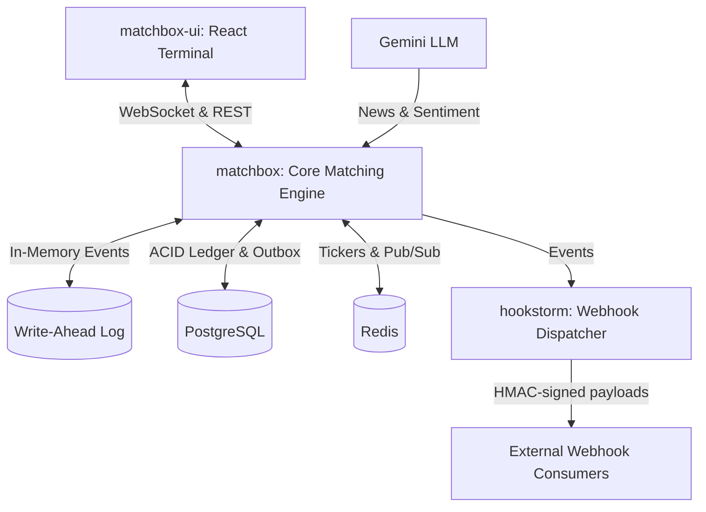

# ParaBu ⚡

[](https://golang.org)
[](https://react.dev)
[](https://vitejs.dev)
[](https://www.postgresql.org)
[](https://redis.io)
[](LICENSE)

**ParaBu** is a high-performance, distributed, enterprise-grade cryptocurrency trading platform and matching ecosystem. Engineered for ultra-low latency, strict financial accuracy, and institutional trading experiences.

---

## 🏛 System Architecture

The repository is organized into three decoupled, high-performance modules:

```
ParaBu/
├── matchbox/       # 🚀 In-memory matching engine, WAL recovery, Ledger, & Market Data Hub (Go)
├── matchbox-ui/    # 💻 High-contrast, institutional-grade dark trading terminal (React + Vite)
└── hookstorm/      # ⚡ High-throughput webhook dispatcher with HMAC SHA-256 signatures & DLQ (Go)
```



---

## 🚀 Key Modules & Capabilities

### 1. `matchbox` (Matching Engine & Backend API)
- **Actor Model Matching Engine:** In-memory, thread-safe, sub-millisecond execution for Limit and Market orders.
- **Write-Ahead Log (WAL) & Crash Recovery:** Zero-data-loss persistence with periodic in-memory snapshots and append-only disk replay upon startup.
- **Real-Time Data Streaming:** Gorilla WebSocket hub publishing live L2 order book depth, trade ticks, 24h tickers, and AI sentiment feeds.
- **ACID Double-Entry Ledger:** Strict PostgreSQL financial auditing with row-level locking (`FOR UPDATE`) and idempotency to eliminate double-spending risks.
- **Transactional Outbox Pattern:** Ensures atomic persistence between order state transitions and external message brokers.
- **AI-Powered Sentiment Engine:** Asynchronous news scraper pipeline integrated with Google Gemini LLM, categorizing impact scores (1-10) and sentiment polarity (Bullish/Bearish/Neutral).
- **Geometric Brownian Motion (GBM) Sandbox:** Built-in high-frequency algorithmic market maker simulating real-world order flows for testing and staging environments.

### 2. `matchbox-ui` (Trading Terminal & Dashboard)
- **Pure Black & Neon Green Aesthetic:** Tailored for professional traders with aggressive contrast (`#050505` base and `#00C853` accents).
- **Depth Visualizer Order Book:** Cumulative volume depth bars with monotonic number formatting, layout-shift-free typography (`JetBrains Mono`), and one-click price targeting.
- **TradingView Lightweight Charts:** Responsive candlestick and area charting with multi-timeframe controls and custom client-side indicators (SMA 20, EMA 9/21/50/200, RSI 14, MACD).
- **Chart News Markers (`NewsMarkerLayer`):** Visual sentiment pins embedded directly onto chart candles showing headline, timestamp, and impact severity.
- **Institutional Fast Order Form:** Tabbed Limit & Market order placement, percentage shortcuts (25%, 50%, 75%, 100%), and client-side balance validation with glowing warning states.
- **Virtualized Trade Feed:** Powered by `@tanstack/react-virtual` with a 100-item ring buffer and flash animations for block orders (> 1 BTC).
- **Global Trading Hotkeys (`useTradingHotkeys`):**
  - <kbd>B</kbd>: Focus Buy form
  - <kbd>S</kbd>: Focus Sell form
  - <kbd>Esc</kbd>: Dismiss active modals & blur inputs
  - <kbd>1</kbd> / <kbd>2</kbd> / <kbd>3</kbd> / <kbd>4</kbd>: Switch timeframe (1m, 15m, 1h, 1d)
  - <kbd>Space</kbd>: Reset chart scale
- **Modular Dashboard Layout:** Built on `react-resizable-panels` with interactive glow handles and persistent panel layout across sessions via `localStorage`.
- **Latency & Connection Monitor:** Real-time WebSocket connection state observer with dynamic color-coded ping measurements.
- **Minimalist Audio & Toast System:** Web Audio API execution chimes and terminal-style stacked status alerts.

### 3. `hookstorm` (Reliable Webhook Delivery)
- **Cryptographic Signing:** Standardized HMAC SHA-256 security headers (`X-ParaBu-Signature`).
- **Redis Sliding-Window Rate Limiting:** Enforces endpoint protection against downstream bottlenecks.
- **Dead Letter Queue (DLQ):** PostgreSQL-backed fallback storage for persistent retries and audit tracking of failed deliveries.

---

## 🛠 Tech Stack

| Domain | Technology |
|---|---|
| **Backend Core** | Go 1.23+, Gin, Gorilla WebSocket, pgx/v5, go-redis/v9 |
| **Frontend Terminal** | React 19, Vite 8, TailwindCSS, TradingView Lightweight Charts, Framer Motion |
| **State & Performance** | Zustand, `@tanstack/react-virtual`, `react-resizable-panels` |
| **Databases** | PostgreSQL 14+ (Ledger & DLQ), Redis 6+ (Sorted Sets & Tickers) |
| **AI Integration** | Google Gemini API (Sentiment & News impact analysis) |
| **Protocols** | WebSockets, REST JSON, UDF (Universal Data Feed for TradingView) |

---

## ⚡ Getting Started

### Prerequisites
- [Go](https://go.dev/) 1.23 or later
- [Node.js](https://nodejs.org/) 18+ and `npm`
- [PostgreSQL](https://www.postgresql.org/) running on `localhost:5432`
- [Redis](https://redis.io/) running on `localhost:6379`

### 1. Database Setup
```bash
# Create database
psql -U postgres -c "CREATE DATABASE parabu_matchbox;"

# Run migrations (located in matchbox/db/migrations)
```

### 2. Configure & Start Backend (`matchbox`)
```bash
cd matchbox
cp .env.example .env
# Edit .env with your environment configuration
go run ./cmd/matchbox
```
The matching engine HTTP server will start on `http://localhost:8080`, and WebSocket on `ws://localhost:8080/ws`.

### 3. Start Frontend Terminal (`matchbox-ui`)
```bash
cd matchbox-ui
npm install
npm run dev
```
Open [http://localhost:5173](http://localhost:5173) in your browser. The frontend is pre-configured to connect to the backend at `localhost:8080`.

### 4. Start Webhook Dispatcher (`hookstorm`)
```bash
cd hookstorm
go run ./cmd/hookstorm
```

---

## 📡 WebSocket Topics

Clients can subscribe to the WebSocket stream by sending:
```json
{
  "action": "subscribe",
  "topics": [
    "depth:BTC/USDT",
    "trade:BTC/USDT",
    "tickers",
    "!news@sentiment"
  ]
}
```

---

## 🔒 Security & Best Practices

- **Zero Secret Leaks:** Configuration keys and credentials are fed via environment variables; `.env` files are strictly git-ignored.
- **Financial Precision:** Currency arithmetic relies on arbitrary-precision decimal representations (`shopspring/decimal`), preventing floating-point rounding errors.
- **Concurrency Safety:** Core matching loops utilize mutexes and single-threaded channels per market pair to guarantee deterministic matching order.

---

## 📄 License
This codebase is developed for internal and institutional trading operations. All rights reserved.
